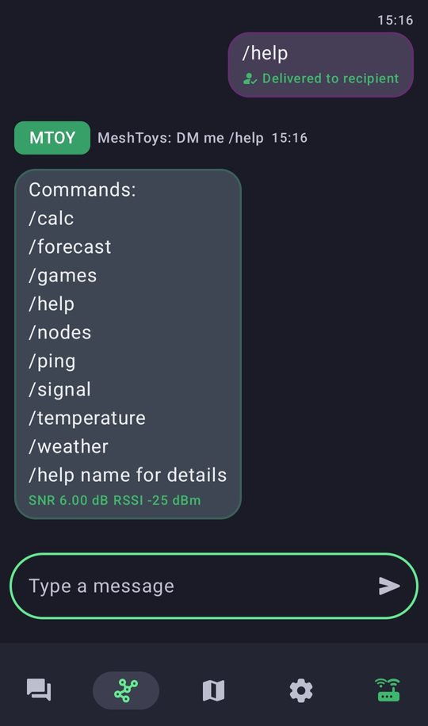
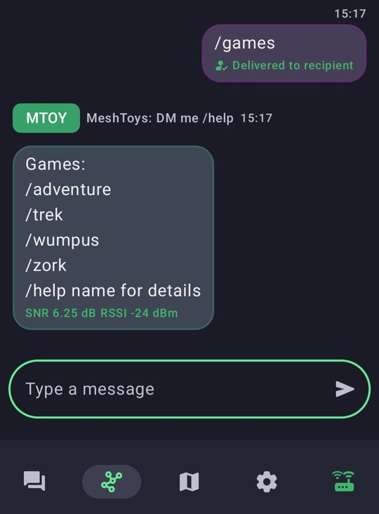
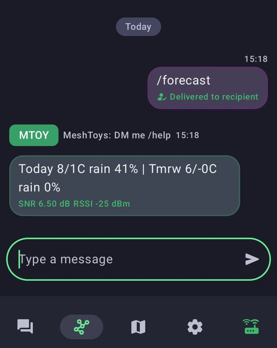
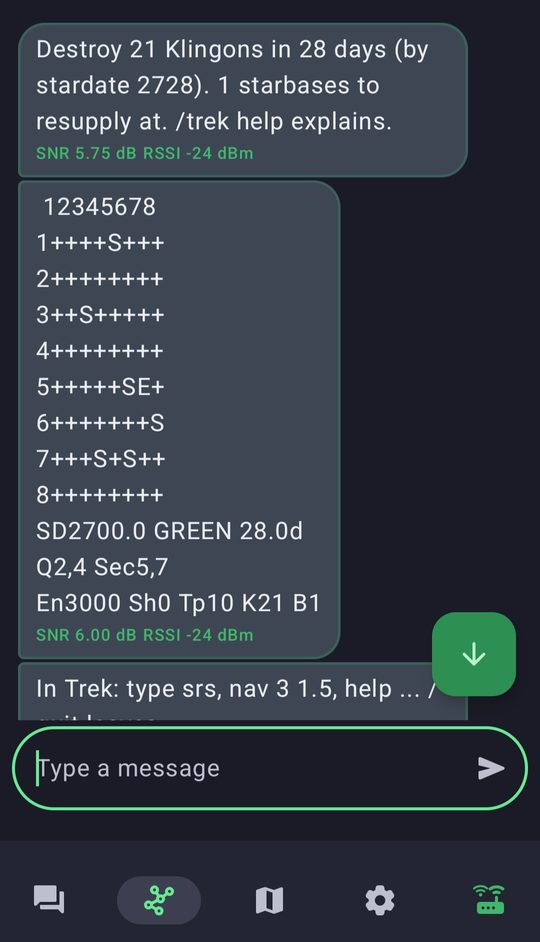

# MeshToys

**Turn a [Meshtastic](https://meshtastic.org) node into a pocket remote control for a PC or Raspberry Pi, and play text adventures over LoRa radio.**

Send a direct message from your handheld node, and the bridge at home runs it and replies over the mesh, with no phone signal or internet needed on your side. Ask for the weather, do a sum, check how well your signal is being heard, or play Zork, Colossal Cave, Hunt the Wumpus or Super Star Trek in 190-byte messages.

<p align="center">
  
  
  
  
</p>

*Screenshots from the Meshtastic Android app, talking to a Heltec V4 bridge node (MTOY) over LoRa.*

## What you need

- A Meshtastic node connected to the machine running the bridge: tested target is a Heltec V4, connected over USB or WiFi.
- Python 3.10 or newer: the tests pass on 3.10 (Linux) and 3.14 (Windows), and the bridge runs on 3.13 on a Raspberry Pi Zero W. Older versions have not been tried.
- Internet access on the bridge machine for `/temperature`, `/weather` and `/forecast` only (they use [Open-Meteo](https://open-meteo.com), no API key). Everything else works offline.

## Quick start

```
git clone https://github.com/Ed-Marsh/MeshToys.git
cd MeshToys
pip install meshtastic pypubsub requests

# USB, auto-detect the port; use your own latitude and longitude for the weather
python mesh_bridge.py --lat 51.50 --lon -0.12 --dm-only
```

Then send `/help` as a direct message to your bridge node from another node. For WiFi connections (`--host`), restricting who can send commands (`--allow`), admin commands and every other option, see the [bridge reference](docs/bridge-reference.md).

To run it unattended, on a Raspberry Pi Zero W with the node plugged in by USB and starting at boot, see [Running on a Raspberry Pi Zero W](docs/raspberry-pi-zero-w.md).

## Built-in commands

| Command | Reply |
|---|---|
| `/temperature` | Current temperature and "feels like" in °C at your base location, plus the same for the caller's location if their node has shared a position. From [Open-Meteo](https://open-meteo.com) (no API key needed). Example: `Home 12.3C (feels 10.1C) \| You 8.8C (feels 6.8C)` |
| `/weather` | Combined reply: the `/temperature` line (base, plus caller if known) then the `/forecast` line. If one lookup fails the other is still sent |
| `/forecast` | Today and tomorrow at your base: high/low in °C and chance of rain. Example: `Today 11/5C rain 40% \| Tmrw 9/3C rain 70%` |
| `/signal` | Radio quality of the caller's message as your node received it: SNR, RSSI and hop count. For a relayed message this is the last hop's link, not the whole path |
| `/nodes` | How many nodes your Heltec has heard in the last hour, how many it knows in total, and the best SNR with that node's short name |
| `/announce` | **Admin only.** Broadcasts the `--announce` preset on the public channel and replies `Sent publicly` |
| `/say text` | **Admin only.** Broadcasts `text` on the public channel. Example: `/say Net tonight 8pm` |
| `/status` | Bridge uptime and host uptime, plus a ping test to the router and to the internet (`Router: ok 1ms`, `Internet: ok 23ms`, or `DOWN`). The addresses are set with `--status-router` and `--status-host` |
| `/reboot yes` | **Admin only.** Reboots the host (Linux only) after a 60 second delay, replying `Rebooting at HH:MM:SS. Send /reboot cancel to stop it`. `/reboot now` goes after about 3 seconds, and `/reboot cancel` stops a pending one. Plain `/reboot` does nothing but remind you of the options. See [Reboot setup](docs/bridge-reference.md#reboot-setup) |
| `/stats` | **Admin only.** Lifetime usage: unique visitors (total, 24h, 7d), commands and games used and how often, errors, and the busiest nodes. Kept in `stats.json` |
| `/calc expression` | Calculator. Supports `+ - * / // % ** ^` (`^` is power), brackets and `!` for factorial (0 to 170). Examples: `/calc 23 * 5 / (10 * 2)` gives `5.75`, `/calc 4!` gives `24`. Very large results are shown in scientific notation, and oversized powers are refused |
| `/ping` | `pong` and the PC's time |
| `/help` | List of available commands, one per line (admin commands only for admin nodes). The games are not listed; use `/games` for those. `/help name` describes one command, e.g. `/help calc` |
| `/games` | List of the games you can play over the mesh. `/help name` describes one, e.g. `/help zork` |

## Admin

Some commands are for the person running the bridge. They only work as a direct message from a node listed with `--admin`, are hidden from `/help` for everyone else, and are ignored if sent publicly:

```
python mesh_bridge.py --lat 51.50 --lon -0.12 --dm-only --admin '!b3725444'
```

- `/stats` shows lifetime usage. The counters are kept in `stats.json` next to the script and written at most every 15 minutes (`--stats-interval-min`), and only when something has changed. Delete the file to reset them.
- `/reboot yes`, `/reboot now` and `/reboot cancel` restart the Raspberry Pi or other Linux host. This needs either a `SUDO_PASSWORD` in a git-ignored `.env` file (copy `.env.example`) or a sudoers rule for `reboot`, as set out in [Reboot setup](docs/bridge-reference.md#reboot-setup).
- `/announce` and `/say` broadcast on the public channel, with a 60 second cooldown.

All the options are in the [bridge reference](docs/bridge-reference.md).

## Games

Send `/games` to list them. Each game starts with its own command, and while you are in a game, every message you send is a game command until `/quit`.

| Command | Game |
|---|---|
| `/trek` | The Super Star Trek game. `/trek` starts or resumes your game and keeps you in it until `/quit`; inside, you type the game's commands without a `/` (`srs`, `nav 3 1.5`). See [Trek](docs/games/trek.md) |
| `/zork` | A text adventure. While you are in it, every message you send is a game command. See [Zork](docs/games/zork.md) |
| `/adventure` | Colossal Cave Adventure, the original cave game. Works like `/zork`: every message you send is a game command until `/quit`. See [Colossal Cave](docs/games/adventure.md) |
| `/wumpus` | Hunt the Wumpus (Gregory Yob, 1973). Works like `/zork`: every message you send is a game command until `/quit`. See [Hunt the Wumpus](docs/games/wumpus.md) |

Once you are in a game, everything you send is game input until you send `/quit`. Your game is saved after every move, per node, so several people can play at once and carry on after a restart.

## More documentation

- [Bridge reference](docs/bridge-reference.md): all options, WiFi setup, adding your own commands, public messages, caller location, security.
- [Raspberry Pi Zero W](docs/raspberry-pi-zero-w.md): wiring, install and start-at-boot.
- [Troubleshooting](docs/troubleshooting.md): a direct message gets no reply.
- Games: [Trek](docs/games/trek.md), [Zork](docs/games/zork.md), [Colossal Cave](docs/games/adventure.md), [Hunt the Wumpus](docs/games/wumpus.md).

## Safety

Anyone who can reach your node over the mesh can trigger commands unless you restrict it. Use `--dm-only`, and `--allow` before adding any command that changes something. See [Security](docs/bridge-reference.md#security).

## Contributing

Pull requests are welcome, whether it's a new command, a new game, a fix or a docs correction. Please run the tests first (see Status below). There is no code of conduct, just don't be a weapon.

## Licence

MeshToys' own code is released under the [MIT licence](LICENSE), with one important exception: **the Zork (Dungeon) game files are non-commercial, hobby use only**, and the Colossal Cave and Wumpus games are ports or rewrites of other people's work with their own notes. Read [`NOTICE`](NOTICE) before you use or share any of the games.

MeshToys is not affiliated with or endorsed by Meshtastic, Infocom, Activision, Microsoft, MIT or any of the people credited in `NOTICE`.

## Status

Early version. Running on a Heltec V4 node; expect rough edges. Tests: `python -m unittest discover -s tests -t .`.
